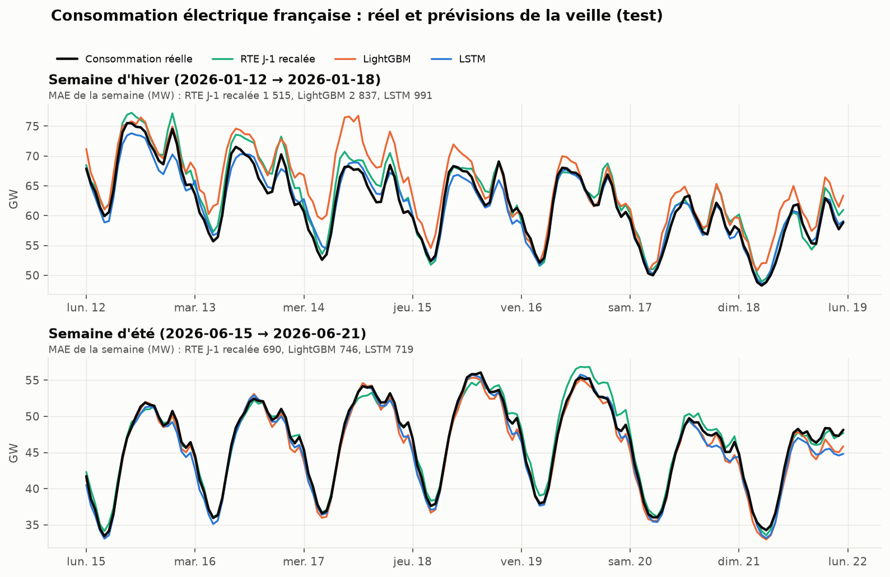
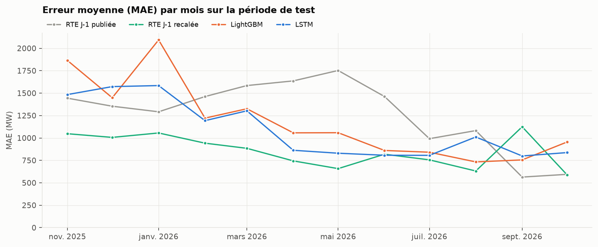
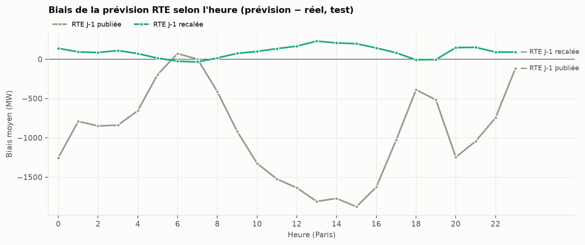

# Prévision de la consommation et simulation des prix de l'électricité en France

Prévoir la consommation française du lendemain heure par heure, comparer honnêtement plusieurs familles de modèles, puis simuler des trajectoires de prix day-ahead.

**État :** étapes 1 à 3 (données, variables, évaluation et références). Les modèles et la simulation viennent ensuite.

## Installation

```bash
python -m venv .venv && source .venv/bin/activate      # Windows : .venv\Scripts\activate
pip install -e ".[dev,api]"
pip install -e ".[lstm]"                               # PyTorch, pour le LSTM (≈ 130 Mo sous Windows)
# Si Windows bloque torch.dll (« Une stratégie de contrôle d'application a bloqué ce fichier ») :
#   pip install "torch==2.10.*"     (version plus ancienne, voir DECISIONS.md D23)
cp .env.example .env                                    # puis colle ton jeton ENTSO-E
cp sources.example.toml sources.toml                    # puis remplis le nom de l'espace de travail
az login --allow-no-subscriptions                       # même compte que celui qui ouvre Fabric
pytest                                                  # tests sur données factices
python scripts/00_inspect_fabric.py                     # vérifie l'accès et les colonnes du silver
```

La consommation vient de la table `export_ml_eco2mix` du Lakehouse `lh_eco2mix` (projet A), lue dans OneLake au format Delta. `--allow-no-subscriptions` est nécessaire si ton compte Fabric n'a pas d'abonnement Azure. Sans accès au Lakehouse, `--source api` télécharge la consommation depuis ODRÉ.

### Table d'export côté projet A

Le silver est écrit par un `MERGE`, qui produit des vecteurs de suppression que la bibliothèque `deltalake` ne sait pas lire. Une dernière cellule du notebook `02_silver_qualite` recrée donc une copie lisible à chaque exécution (voir DECISIONS.md, D13) :

```python
spark.sql("""
CREATE OR REPLACE TABLE export_ml_eco2mix
TBLPROPERTIES ('delta.enableDeletionVectors' = 'false')
AS SELECT ts_utc, pas_min, nature, priorite_nature,
          consommation, prevision_j, prevision_j1, taux_co2,
          nucleaire, eolien, solaire, hydraulique, gaz, charbon, fioul, bioenergies,
          ech_physiques, pompage, stockage_batterie, destockage_batterie
FROM silver_eco2mix
""")
```

Vérification : `DESCRIBE DETAIL export_ml_eco2mix` doit indiquer `minReaderVersion = 1`.

### Compléter l'historique du Lakehouse

Le projet A charge les données depuis le 01/01/2024 ; le découpage du projet C a besoin des données depuis le 01/10/2021. Dans Fabric, sans toucher au code du projet A :

1. Exécuter `01_bronze_ingestion` avec `dataset = "eco2mix-national-cons-def"` et `date_debut = "2021-10-01"`.
2. Exécuter `02_silver_qualite` avec `fenetre_jours = 1870` le 11/11/2026 (ajouter 1 par jour de retard). Le filtre compare des instants (`current_timestamp() - INTERVAL n DAYS`), pas des dates : deux jours de marge évitent de perdre les premiers relevés du 01/10/2021, datés du 30/09 à 22 h UTC.
3. Remettre les paramètres par défaut : `dataset = "eco2mix-national-tr"`, `jours_glissants = 3`, `date_debut = ""` dans le notebook 01 ; `fenetre_jours = 5` dans le notebook 02.
4. Relancer `python scripts/00_inspect_fabric.py` : la ligne « Couverture » doit afficher OK.

Le `MERGE` sur `ts_utc` insère les nouvelles lignes sans toucher aux existantes.

**Fait le 11/11/2026.** Silver du 01/10/2021 (heure de Paris) au 11/11/2026, aucune valeur vide pour `consommation` ni `prevision_j1`. Les relevés absents correspondent exactement aux défauts connus de la source : une heure à chaque passage à l'heure d'hiver et un relevé le 01/01/2026.

### Si la lecture depuis ton ordinateur échoue

Exécute cette cellule dans un notebook Fabric attaché à `lh_eco2mix` et colle la sortie :

```python
df = spark.table("silver_eco2mix")
df.printSchema()
df.selectExpr("min(ts_utc)", "max(ts_utc)", "count(*)").show()
```

## Exécution

```bash
python scripts/00_inspect_fabric.py      # une fois : schéma et couverture du silver
python scripts/01_download.py            # options : --source api, --sans-prix
python scripts/02_build_dataset.py       # jeu horaire + rapport de qualité
python scripts/03_evaluate_baselines.py  # références, suivies dans MLflow
python scripts/04_train_models.py        # régression, LightGBM, LSTM (réglage sur validation, puis test)
                                         # un seul modèle : --modeles lstm
python scripts/05_compare.py             # tableau comparatif relu depuis MLflow
python scripts/06_diagnostics.py         # biais, erreurs par saison / mois / heure
python scripts/07_ensemble.py            # combinaison des modèles (poids choisis sur la validation)
python scripts/08_figures.py             # graphiques du README (reports/figures/)
python scripts/09_train_final.py         # modèle servi par l'API (models/)
uvicorn elecfr.api:app --reload          # API : http://127.0.0.1:8000/docs
mlflow ui --backend-store-uri sqlite:///mlflow.db   # http://127.0.0.1:5000
```

## Découpage

| Période | Dates | Durée |
|---|---|---|
| Entraînement | 2021-11-01 → 2024-10-31 | 3 ans |
| Validation | 2024-11-01 → 2025-10-31 | 12 mois |
| Test (walk-forward mensuel) | 2025-11-01 → 2026-10-31 | 12 mois |

## Résultats

Chiffres issus des exécutions réelles du 12/11/2026 (walk-forward mensuel), relus depuis MLflow par `05_compare.py`.

| Modèle | MAE validation (MW) | MAE test (MW) | MAPE test (%) | Test : écart vs RTE recalée |
|---|---|---|---|---|
| Naïf saisonnier (J-7) | 3 384 | 3 499 | 6,54 | +310 % |
| Prévision J-1 RTE, publiée | 1 308 | 1 267 | 2,49 | +48 % |
| **Prévision J-1 RTE, recalée** | **914** | **853** | **1,68** | 0 |
| Régression linéaire (Ridge, alpha = 100) | 1 300 | 1 329 | 2,67 | +56 % |
| LightGBM (1 000 arbres, 31 feuilles) | 1 204 | 1 185 | 2,28 | +39 % |
| LSTM encodeur-décodeur (32 neurones) | 1 089 | 1 091 | 2,09 | +28 % |
| **Combinaison (0,1 régression + 0,3 LightGBM + 0,6 LSTM)** | **1 015** | **1 024** | **1,96** | +20 % |

« RTE recalée » = prévision publiée moins son biais moyen par heure sur les 28 derniers jours connus la veille (aucune information du futur).

### 1. Le LSTM est le meilleur des modèles appris

Il fait 8 % de mieux que LightGBM sur le test (1 091 contre 1 185 MW), avec un score stable entre validation et test (1 089 et 1 091 MW). Ce n'est pas LightGBM qui bat le LSTM, mais l'inverse, et le diagnostic dit pourquoi.

- **Ce n'est pas d'abord un effet d'hiver.** Le LSTM gagne autant au printemps (test : 1 000 contre 1 148 MW, −13 %) et en automne (1 038 contre 1 189, −13 %) qu'en hiver (1 459 contre 1 600, −9 %). L'hypothèse « les arbres n'extrapolent pas au-delà des températures vues » n'explique donc pas l'essentiel.
- **Il gagne quand la consommation évolue de façon continue.** C'est le cas en janvier (test : 1 584 contre 2 093 MW, −24 % ; validation : −27 %), lors des vagues de froid et des intersaisons. Il lit les 168 dernières heures d'affilée, alors que LightGBM ne voit que trois valeurs isolées (J-2, J-7, J-14 à la même heure) : il suit mieux le niveau récent.
- **Il perd aux ruptures de calendrier.** En décembre (fêtes) et en août (congés d'été), il fait moins bien que LightGBM, et il surestime : biais de +1 333 MW en décembre 2024, +789 MW en décembre 2025, +437 MW en août 2025. La semaine qu'il vient de lire était une semaine normale ; il en prolonge le niveau.
- **Il est nettement meilleur la nuit** (environ 800 à 900 MW de 0 h à 5 h sur le test, contre environ 1 100 MW pour LightGBM). Il est comparable en journée.
- **En été, LightGBM garde un léger avantage** : 811 contre 876 MW sur le test.

### 2. LightGBM bat la prévision publiée de RTE, mais pas RTE

Face à la prévision publiée, LightGBM et le LSTM semblent gagner. Cet avantage tient à un **décalage de niveau**.

- **La prévision publiée vise la consommation temps réel.** Son biais est de −1 152 MW face à la vérité consolidée (jusqu'au 31/08/2026), mais seulement de +135 MW face à la vérité temps réel (sept.-oct. 2026). Sur cette dernière période, RTE fait 579 MW de MAE.
- **Recalée avec la seule information de la veille, RTE redevient nettement la meilleure** : 853 MW sur le test, devant tous nos modèles, dans chaque saison.
- **Le recalage a la limite attendue au changement de vérité.** En septembre 2026, le biais appris sur août (consolidé) est appliqué à une vérité temps réel : RTE recalée monte à 1 125 MW, contre 564 MW pour la version publiée. En octobre, elle retombe à 589 MW.
- **Le biais de RTE dépend de l'heure** : près de −1 900 MW entre 13 h et 15 h, −1 250 MW à minuit et à 20 h, presque nul de 6 h à 7 h. La production solaire ne peut pas l'expliquer seule ; la cause précise reste ouverte.

### 3. La combinaison fait mieux que chaque modèle

Poids choisis sur la validation (grille au pas de 0,1) : 0,1 régression, 0,3 LightGBM, 0,6 LSTM. Elle obtient 1 015 MW sur la validation et 1 024 MW sur le test, soit 6 % de mieux que le LSTM seul. Le gain se maintient de la validation au test : les poids ne sont pas sur-ajustés. Le LSTM porte l'essentiel du poids. LightGBM corrige ses écarts aux ruptures de calendrier ; la régression, avec un petit poids, apporte son effet linéaire du chauffage.

### 4. Ordre sur le test

RTE recalée (853) < **combinaison (1 024)** < LSTM (1 091) < LightGBM (1 185) < RTE publiée (1 267) < régression linéaire (1 329) < naïf (3 499).

**Pistes d'amélioration.** Des indicateurs de fêtes et de congés plus fins (semaine de Noël, ponts d'août) pour le LSTM ; un LSTM de 16 neurones (le réglage retenu est au bord de la grille).

Heures exclues, sur chaque période : l'heure absente de la source au passage à l'heure d'hiver, et, pour le naïf, l'heure dont la référence J-7 tombe sur 2 h le jour du passage à l'heure d'été (heure qui n'existe pas).

Qualité des entrées : la prévision de température à 8 villes s'écarte de la température observée de 1,31 °C en moyenne (95e centile : 3,38 °C). C'est le prix de la règle « aucune fuite ».

## Graphiques

Produits par `08_figures.py` à partir des prévisions du test.



Sur la semaine d'hiver du 12 au 18 janvier 2026, LightGBM surestime nettement en milieu de semaine (MAE 2 837 MW). Le LSTM suit la courbe de près (991 MW) et fait même mieux que RTE recalée (1 515 MW). En été (15 au 21 juin 2026), les trois sont proches : RTE recalée 690 MW, LSTM 719 MW, LightGBM 746 MW.



RTE recalée est la plus régulière, sauf en septembre 2026, quand la vérité passe du consolidé au temps réel (voir plus haut). LightGBM décroche en novembre et en janvier ; le LSTM est plus stable en hiver.



La prévision publiée est jusqu'à 1 900 MW sous la consommation consolidée en milieu de journée, et autour de 1 250 MW la nuit. Recalée sur les 28 derniers jours connus, son biais reste sous 250 MW à toute heure.

## API

```bash
python scripts/09_train_final.py         # une fois : entraîne et enregistre le modèle servi
uvicorn elecfr.api:app --reload          # documentation interactive : http://127.0.0.1:8000/docs
```

| Route | Rôle |
|---|---|
| `GET /health` | état, modèle chargé, période des données |
| `GET /forecast?date=AAAA-MM-JJ` | prévision horaire du jour (heure de Paris), avec la valeur réelle et la prévision RTE quand elles existent |
| `GET /simulate?month=AAAA-MM` | simulation des prix : renvoie 501 tant que le volet 2 n'existe pas |

- **Modèle servi : LightGBM.** Le LSTM est 8 % plus précis, mais imposerait PyTorch dans l'image (voir DECISIONS.md, D25).
- **Mode « rejeu ».** L'API prévoit tout jour présent dans le jeu de données, avec les variables connues la veille. Pour un jour vu à l'entraînement, la réponse le signale (`dans_la_periode_d_entrainement`) : l'erreur affichée y est optimiste.
- **Prévoir demain en direct** demanderait de construire la ligne de demain (prévision météo du jour, consommation jusqu'à J-2 depuis le Lakehouse). C'est l'étape suivante.

## Docker

```bash
docker build -t elecfr-api .
docker run --rm -p 8000:8000 -v "$PWD/data:/app/data" -v "$PWD/models:/app/models" elecfr-api
```

L'image ne contient que les dépendances de l'API (pas MLflow, deltalake ni PyTorch) ; le jeu de données et le modèle sont montés au lancement. GitHub Actions lance les tests (sauf ceux du LSTM, qui demandent PyTorch) puis construit l'image à chaque push.

## Choix méthodologiques

Voir [DECISIONS.md](DECISIONS.md).

## Sources de données

- RTE éCO2mix : Lakehouse Fabric du projet A, ou ODRÉ (`eco2mix-national-cons-def`, `eco2mix-national-tr`)
- Open-Meteo : API Previous Runs (prévisions archivées) et Archive (observations, analyse seulement)
- ENTSO-E Transparency Platform : prix day-ahead, zone France
- Calendrier scolaire : data.education.gouv.fr ; jours fériés : bibliothèque `holidays`
